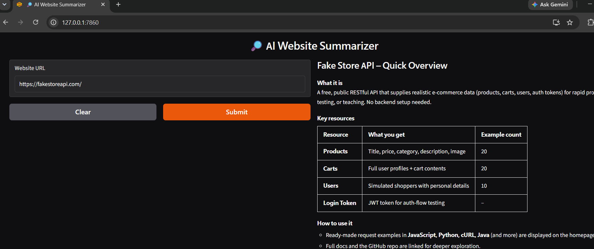

# 🌐 AI-Powered Website Summarizer
An AI-powered application that summarizes website content using Python, OpenAI API, and Gradio.
Simply enter a website URL, and the application extracts the webpage content and generates a concise, easy-to-read summary within seconds.
---
## ⚙️ How It Works

1. 🌐 User enters a website URL
2. 📄 Application extracts text from the webpage
3. 🤖 OpenAI LLM analyzes the content
4. 📝 AI generates a concise summary
5. 🎯 User receives a clear overview of the website
## 🛠️ Tech Stack
- Python
- OpenAI API
- Gradio
- BeautifulSoup
- Requests

## 📸 Application Demo

