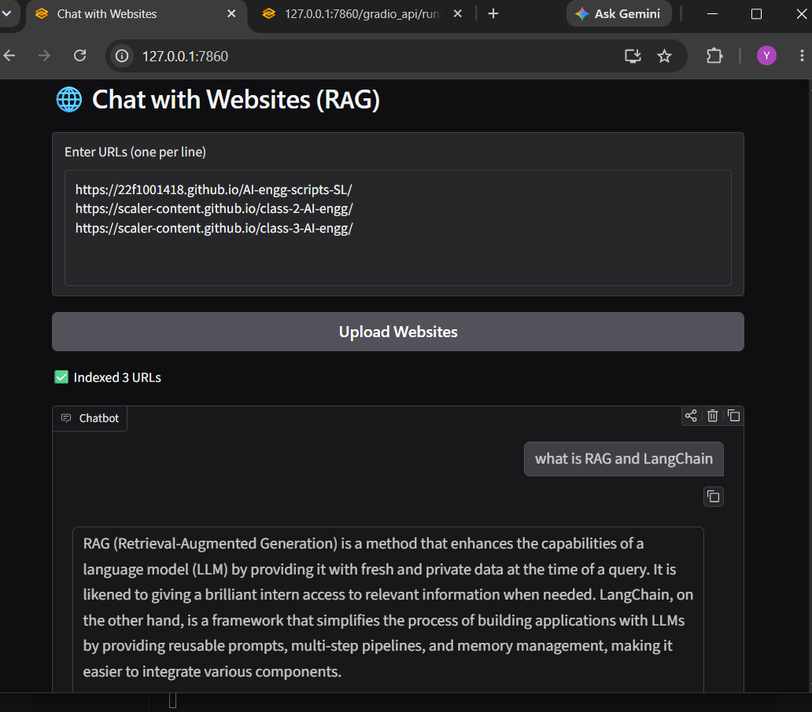

# 📄 Chat With PDF & Website RAG

A Generative AI application that allows users to chat with PDF documents and websites using LangChain, OpenAI, ChromaDB, and Gradio.

## 🚀 Features

### PDF Question Answering

- Upload PDF documents
- Ask questions in natural language
- Retrieval-Augmented Generation (RAG)
- Context-aware responses

## 📸 Chat With PDF

---

### Website Question Answering

- Index website content
- Query multiple URLs
- Semantic search using embeddings
- Interactive Gradio interface

## 📸 Chat With Websites

## 🛠️ Tech Stack

- Python
- LangChain
- OpenAI
- ChromaDB
- Gradio