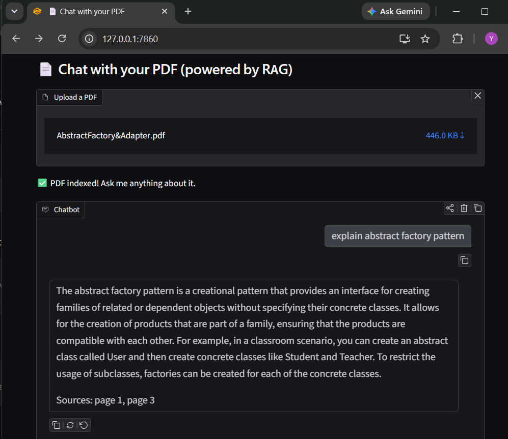

# 📄 Chat With PDF & Website RAG

AI application that allows users to chat with PDF documents and websites.
The idea is simple: Upload a PDF, ask questions, and get answers based on the actual document content, along with relevant page references.
The trick is called RAG (Retrieval-Augmented Generation): 
🔪 Chop the doc into chunks 
📍 Turn each chunk into a vector (a "coordinate of meaning") 
🔎 For every question, find the 3 nearest chunks 
📋 Hand them to the LLM and let it answer from real text 

## 🚀 Features
### PDF Question Answering
- Upload PDF documents
- Ask questions in natural language
- Retrieval-Augmented Generation (RAG)
- Context-aware responses
## 🛠️ Tech Stack

- Python
- LangChain
- OpenAI
- ChromaDB
- Gradio

## 📸 Chat With PDF

---

### Website Question Answering

- Index website content
- Query multiple URLs
- Semantic search using embeddings
- Interactive Gradio interface

## 📸 Chat With Websites

